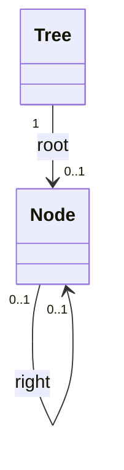
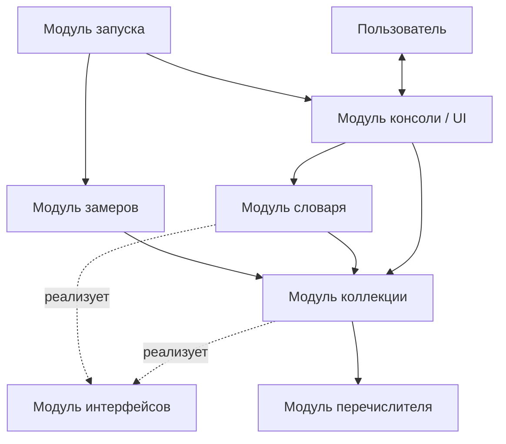

# Дизайн AVL-дерева и словаря

## 1. Постановка задачи

### 1.1. Что разрабатывается

Разрабатывается AVL-дерево поиска, представляющее упорядоченное множество уникальных элементов. Для типов элементов без собственного порядка предусматривается словарь `IDictionary`: он хранит значения по сравнимым ключам, не сравнивая сами значения.

Для дерева задаются операции поиска, добавления и удаления, обходы, преобразования, работа с поддеревьями и текстовое представление. Программа предоставляет консольный интерфейс и режим замеров производительности.

### 1.2. Общий класс задач

Работа изучает организацию упорядоченных данных в динамической структуре поиска и принципы поддержания её сбалансированности. Самостоятельное практическое применение программы не предполагается.

## 2. Сущности

### 2.1. Сущности и описание

| Сущность | Описание |
| --- | --- |
| Дерево | Структура, содержащая узлы. Пустое дерево не имеет корневого узла. В непустом дереве ключи левого поддерева меньше ключа узла, а ключи правого — больше. |
| Узел | Хранит элемент дерева, ссылки на левого и правого потомков, высоту и размер поддерева. В словаре элемент узла является парой «ключ — значение». |

### 2.2. Связи между сущностями

- Дерево имеет не более одного корневого узла.
- Узел имеет не более одного левого и одного правого потомка.
- Каждый потомок сам является корнем поддерева, поэтому связи `left` и `right` рекурсивно связывают узлы дерева.

## 3. Архитектура

### 3.1. Модули

| Модуль | Назначение |
| --- | --- |
| Модуль коллекции | AVL-множество: упорядочивание элементов, балансировка, обходы, преобразования, поддеревья, операторы и текстовая запись/чтение дерева. Реализует контракты коллекции и перечислимой последовательности. |
| Модуль интерфейсов | Контракты `ICollection`, `IEnumerable` и `IEnumerator`; дополняется контрактом `IDictionary`. |
| Модуль перечислителя | Последовательно выдаёт элементы AVL-множества в порядке возрастания. |
| Модуль словаря | Предоставляет `IDictionary` и хранит значения по сравнимым ключам, используя AVL-структуру. |
| Модуль консоли (UI) | Принимает команды и параметры, вызывает операции коллекции и словаря, выводит результаты и сообщения об ошибках. |
| Модуль замеров | Измеряет время операций AVL-множества и записывает результаты для последующего просмотра. |
| Модуль запуска | Выбирает запуск консольного режима или режима замеров. |

### 3.2. Связи между модулями

### 3.3. Решения

**Порядок элементов дерева.** Дерево использует отношение `<`, определённое для типа элемента; отдельный параметр-компаратор не задаётся. Элементы считаются эквивалентными, если ни один из них не меньше другого. Поэтому само множество предназначено для сравнимых типов.

**Словарь для несравнимых значений.** `IDictionary<TKey, TValue>` хранит пары по ключу: сравниваются только ключи, а значение может быть несравнимым типом, например указателем на функцию или записью. Ключ должен поддерживать `<`. Например, функцию можно хранить под целочисленным идентификатором. Повторный ключ обозначает обновление связанного значения.

**AVL-балансировка.** Для каждого узла разность высот левого и правого поддеревьев по модулю не превышает единицу. После вставки или удаления высоты пересчитываются на пути к корню. Дисбаланс исправляется одинарным поворотом либо двойным поворотом из двух одинарных; порядок элементов при этом сохраняется.

**Высота и размер поддерева.** Узел хранит высоту для балансировки и количество элементов своего поддерева для индексного доступа. Размеры и высоты пересчитываются после изменения потомков. Поиск, вставка, удаление и получение элемента по индексу имеют сложность `O(log N)` при AVL-балансе.

**Обходы и перечисление.** Порядки обхода задаются перестановками корня, левого и правого поддеревьев. Перечисление по возрастанию хранит собственный путь по дереву; изменение дерева делает активный перечислитель недействительным.

**Преобразования и поддеревья.** `map`, `where`, `reduce` и слияние используют обход элементов по возрастанию. Поддерево копируется вместе с его формой. Для проверки вхождения сначала находится узел с ключом корня образца, затем сравниваются форма и элементы.

**Текстовое представление.** Строка формата задаёт порядок записи корня, левого и правого поддеревьев. Скобки ограничивают каждую часть, благодаря чему из строки восстанавливаются и элементы, и форма дерева. При чтении проверяются синтаксис, порядок элементов и AVL-баланс.

**Замеры.** Для воспроизводимости порядок данных задаётся seed. Вставка, поиск и удаление измеряются отдельно на наборах разного размера; поиск дерева сопоставляется с бинарным поиском в отсортированном массиве. Результаты сохраняются в таблицу и могут отображаться графиком.

## 4. Функциональные требования

### 4.1. Требования к коллекции

- Добавление элемента; повторный элемент не меняет множество.
- Поиск элемента и удаление; удаление отсутствующего элемента не меняет множество.
- Получение количества элементов, высоты, признака пустоты и элемента по индексу в порядке возрастания. Индекс вне диапазона приводит к ошибке.
- Сохранение порядка бинарного дерева поиска и AVL-баланса после добавления и удаления.
- Перебор элементов в порядке возрастания и шесть вариантов обхода узлов.
- `map` создаёт новое множество из результатов преобразования; `where` оставляет элементы, прошедшие условие; `reduce` сворачивает элементы с начальным значением.
- Извлечение копии поддерева по элементу-корню и проверка вхождения поддерева с учётом его формы и элементов.
- Сравнение множеств, объединение без повторов и вывод дерева.

### 4.2. Требования к словарю

- Добавление пары «ключ — значение»; добавление существующего ключа обновляет его значение.
- Получение значения по ключу, проверка наличия ключа и удаление пары по ключу.
- Получение количества пар и перечисление пар в порядке ключей.
- Тип значения не обязан поддерживать сравнение; тип ключа должен иметь отношение `<`.

### 4.3. Требования к текстовому представлению

- Запись дерева в текст с фиксированным порядком обхода и с заданной строкой формата.
- Восстановление дерева из текста с сохранением его формы.
- Отклонение неверного формата, повреждённых данных, нарушения порядка и несбалансированной структуры.
- Для типа элемента, используемого в текстовом формате, должны быть доступны операции потокового чтения и записи.

### 4.4. Требования к консоли

- Ручное добавление, поиск и удаление элементов, выбор обхода, индексный доступ, операции преобразования и объединения.
- Извлечение и проверка вхождения поддерева, текстовая запись и чтение, просмотр схемы дерева.
- Демонстрация работы словаря на значениях, которые сами не сравниваются.
- Автоматическое заполнение с заданными количеством элементов, диапазоном и seed.
- Ошибочный ввод или недопустимая операция сопровождаются сообщением и не завершают программу аварийно.

### 4.5. Требования к замерам

- Отдельное измерение вставки, поиска и удаления на случайных наборах с воспроизводимым seed.
- Возможность задавать верхний размер набора в пределах от `10^4` до `10^8` элементов с учётом доступных ресурсов.
- Сохранение таблицы результатов и сравнение поиска AVL-множества с бинарным поиском в отсортированном массиве.
