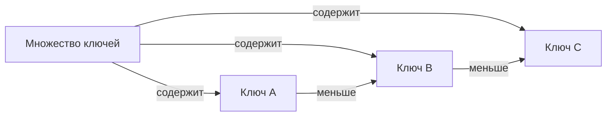
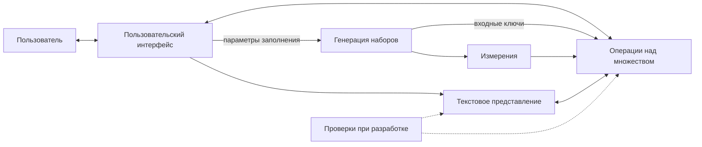

# Дизайн: упорядоченное множество на сбалансированном бинарном дереве

## 1. Постановка задачи

### 1.1. Идея и концепция

Требуется создать программу, которая хранит множество уникальных значений в форме упорядоченной бинарной иерархии. Для любого выбранного значения меньшие ключи относятся к левой части иерархии, большие — к правой. Высоты частей должны оставаться близкими, чтобы операции не деградировали до последовательного просмотра всех значений.

Программа предоставляет операции над множеством, разные способы обхода, преобразование и фильтрацию данных, работу с подмножествами, а также запись и восстановление структуры в текстовом виде.

### 1.2. Для чего может применяться

Такой тип данных полезен в задачах, где набор значений динамически меняется, а поиск, добавление и удаление должны оставаться быстрыми: например, при хранении идентификаторов, индексов или словаря уникальных упорядоченных ключей. Лабораторная работа рассматривает общий принцип организации таких данных и проверяет его на различных типах значений.

## 2. Сущности прикладной задачи

### 2.1. Сущности и описания

В задаче выделяются следующие предметные понятия:

| Сущность | Описание |
| --- | --- |
| Значение-ключ | Элемент данных, который добавляется в множество и по которому выполняется поиск. Ключи должны иметь определённый порядок сравнения. |
| Множество ключей | Набор хранимых значений без повторов. Повтором считается значение, эквивалентное существующему по принятому порядку сравнения. |

Ветви, узлы, ссылки и классы программы не выделяются как самостоятельные предметные сущности: это способы представить и обработать множество.

### 2.2. Связи между сущностями

- Множество содержит ноль или более значений-ключей.
- Правило сравнения применяется к парам ключей и определяет, какой ключ меньше, больше или эквивалентен другому. Для комплексных чисел и составных записей это правило выбирается явно.
- При выборе ключа остальные значения образуют две группы: меньшие ключи и большие ключи. Повторение такого разбиения задаёт левую и правую части дерева и вложенные подмножества.

## 3. Архитектура решения

### 3.1. Высокоуровневые компоненты

1. **Пользовательский интерфейс** принимает команды и параметры, выводит результаты и сообщает об ошибках.
2. **Компонент операций над множеством** выполняет поиск, изменение набора, балансировку, обходы, преобразования и операции с подмножествами.
3. **Компонент представления данных** преобразует структуру в текст и восстанавливает её из текста по выбранному порядку обхода.
4. **Компонент генерации наборов** создаёт воспроизводимые наборы входных значений для пользовательского режима и измерений.
5. **Компонент измерений** оценивает время основных операций на наборах разного размера и подготавливает данные для графика.
6. **Средства проверки** проверяют корректность операций, граничные случаи и сохранение инвариантов после изменений.

### 3.2. Связи между компонентами

### 3.3. Компоненты и ключевые решения

**Пользовательский интерфейс.** Предоставляет ручное управление набором и отдельный сценарий автоматического заполнения. Пользователь может задавать объём, границы значений и начальное состояние генератора, чтобы повторить тот же набор.

**Операции над множеством.** Поиск, добавление и удаление используют отношение порядка между ключами. После изменения высоты частей дерева пересчитываются; при нарушении баланса выполняются одинарные или двойные повороты. Для индексного получения в каждой части дерева учитывается число входящих в неё ключей. За счёт поддержания высоты порядка `log n` основные операции и индексное получение значения выполняются за `O(log n)` в худшем случае.

Обходы представлены шестью перестановками корня, левой и правой частей. На их основе выполняются последовательный перебор и свёртка значений. Преобразование строит новое множество, фильтрация сохраняет только прошедшие условие значения. Если преобразованные значения совпадают, в результате остаётся один ключ.

При извлечении подмножества сохраняется вся часть дерева, начинающаяся с заданного ключа. Проверка вхождения сначала находит ключ-корень кандидата, затем сверяет значения и структуру соответствующих ветвей. Сравнение двух множеств выполняется последовательным сопоставлением их отсортированных обходов.

**Текстовое представление.** Формат определяет порядок трёх частей: корня (`К`), левой (`Л`) и правой (`П`). Программа поддерживает все шесть порядков. Чтение проверяет корректность формата, значений, порядка ключей и баланса. Пустое представление обозначает пустое множество; лишние или повреждённые секции отклоняются.

**Типы значений.** Проверка решения охватывает целые и вещественные числа, комплексные числа, строки, указатели на функции, записи студентов и записи преподавателей. Для комплексных и составных значений используется явно определённое правило сравнения.

**Измерения.** Наборы строятся в случайном порядке с фиксируемым начальным состоянием генератора. Вставка, успешный поиск и удаление измеряются отдельно. Для оценки поиска результат сопоставляется с бинарным поиском в отсортированном массиве; различие в стоимости обновлений учитывается при выводах, поскольку изменение отсортированного массива требует сдвига элементов.

**Проверки.** Проверяются четыре случая дисбаланса и их повороты, операции поиска и удаления, все форматы обхода, обобщённые типы, работа с подмножествами, а также длинная последовательность случайных изменений относительно независимой упорядоченной модели.

## 4. Функциональные требования

### 4.1. Требования к множеству

1. Пользователь или вызывающая сторона может добавить ключ. Если эквивалентный ключ уже есть, набор остаётся без изменений.
2. Можно проверить наличие ключа и удалить его. Удаление отсутствующего ключа не меняет набор.
3. После успешного добавления или удаления структура сохраняет упорядоченность и баланс.
4. Доступны число элементов, высота и проверка пустого состояния.
5. Можно получить ключ по его индексу в отсортированном порядке. Индекс вне диапазона приводит к понятной ошибке.
6. Доступны сравнение множеств на равенство и объединение двух множеств.

### 4.2. Требования к обходам и преобразованиям

1. Пользователь может выбрать любой из шести порядков посещения корня и двух поддеревьев.
2. Перечисление выдаёт элементы по возрастанию, поддерживает переход к следующему значению, получение текущего значения и сброс к началу.
3. Получение текущего значения до начала обхода или после его завершения приводит к ошибке. Изменение или уничтожение множества делает активное перечисление недействительным.
4. `map` применяет функцию к каждому значению и формирует новое множество, которое может иметь другой тип ключей.
5. `where` формирует новое множество из значений, прошедших условие.
6. `reduce` сворачивает значения по возрастанию, начиная с заданного начального значения.

### 4.3. Требования к подмножествам

1. По заданному ключу можно получить соответствующее поддерево целиком.
2. Если ключ-корень отсутствует, результат извлечения пуст.
3. Можно проверить, содержится ли заданное поддерево в другом множестве. Проверка учитывает ключи и форму поддерева; пустое дерево считается входящим в любое дерево.

### 4.4. Требования к тексту

1. Структуру можно сохранить в текст фиксированным порядком обхода и восстановить из этого текста.
2. Можно выбрать порядок обхода строкой формата для сохранения и чтения.
3. Восстановление отклоняет неправильный формат, повреждённые данные, нарушение порядка ключей и несбалансированное дерево.
4. Текстовые значения, содержащие пробелы и специальные символы, должны сохраняться без потери содержимого.

### 4.5. Требования к интерфейсу и проверке производительности

1. Через меню доступны добавление, поиск, удаление, выбор обхода, индексное получение, преобразования, слияние, извлечение и проверка поддерева, текстовое сохранение и восстановление, вывод схемы и демонстрация типов значений.
2. Автоматическое заполнение принимает количество значений, нижнюю и верхнюю границы и seed. Ошибки ввода объясняются пользователю без аварийного завершения программы.
3. Измерения охватывают наборы от `10^4` до `10^8` значений; верхняя граница выбирается с учётом ресурсов компьютера.
4. Для каждого размера отдельно фиксируется время вставки, поиска и удаления. Поиск сопоставляется с бинарным поиском на отсортированном массиве.
5. Результаты измерений можно представить в табличном виде и на графике зависимости времени от размера набора.

## 5. Критерии приёмки

- четыре вида дисбаланса корректно устраняются поворотами;
- после случайных добавлений и удалений множество сохраняет порядок, баланс и согласованный размер;
- операции с пустым множеством, повторными и отсутствующими ключами обрабатываются предсказуемо;
- чтение и запись проходят для всех шести форматов и отклоняют повреждённые данные;
- проверены все типы значений, указанные в варианте;
- интерфейс поддерживает ручной ввод и воспроизводимое автоматическое заполнение;
- измерения создают таблицу и график для фактически выполненных размеров, а отчёт явно указывает верхний измеренный размер и условия запуска.
